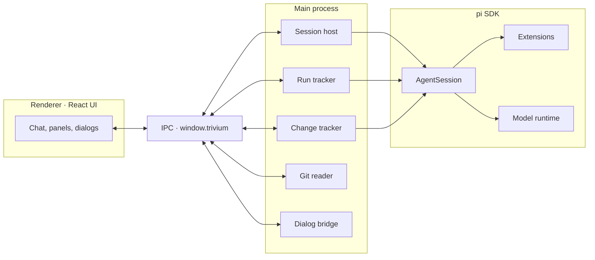

# How it works

## pi, in-process

Trivium embeds the pi SDK **in the Electron main process**. There is no CLI subprocess and no RPC layer — the app drives `AgentSession` directly, and every conversation is an ordinary pi session on disk.

That has two consequences:

- Sessions are portable — open the same session in the pi CLI and continue it there.
- Everything pi supports — extensions, skills, providers — works in Trivium unchanged.

## Modes are agent profiles

Each mode is an **agent profile** assembled at session start:

- a **tool whitelist** (Code gets `read` / `bash` / `edit` / `write`; Research gets no shell; Write gets restrained editing tools),
- a **system-prompt delta** that tunes behavior for the mode's job,
- an **extensions directory** — `~/.trivium/apps/<app>/extensions/` — loaded only for that mode.

## Architecture

The renderer never touches pi directly. It talks to the main process over a typed `window.trivium` bridge exposed by the preload script; the main process owns the session, tracks runs and diffs, reads git state, and renders extension UI requests as native dialogs.

## Where the data lives

Sessions and logins are shared with the pi CLI; Trivium's own state stays under `~/.trivium`.

| Path | What lives there |
|------|------------------|
| `~/.pi/agent/sessions` | Conversation sessions — plain pi sessions, openable in the pi CLI |
| `~/.pi/agent/auth.json` | Model provider logins, shared with pi |
| `~/.trivium` | Trivium's own preferences and state |
| `~/.trivium/apps/<app>/settings.json` | Per-mode model, permission level and extension toggles |
| `~/.trivium/apps/<app>/extensions/` | Extensions loaded only in that mode |
| `~/.trivium/memory/` | Global memory and daily logs (project memory is the project's own `MEMORY.md`) |
| `~/.trivium/connectors/` | MCP server configs and login state |

:::note[Early preview]
The exact layout under `~/.trivium` may evolve between preview releases; this table reflects the current structure.
:::
